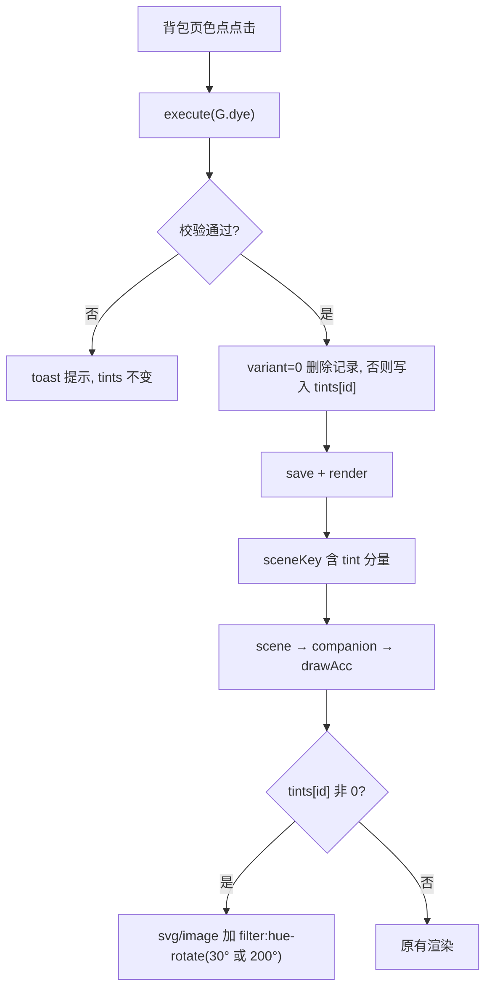

# 配饰染色变体

Feature Name: accessory-dye-variants
Updated: 2026-11-12

## Description

为 16 件配饰增加 3 档纯外观染色（本色 / 暖调 +30° / 冷调 +200°）。玩家在背包页点色点即染色，免费、无限次、即时生效；结果以 `tints` 字段入库持久化，渲染层用 CSS `hue-rotate` 实现，不改动 PNG 素材、WEAR_POS 与配饰数值。

## Architecture

## Components and Interfaces

- `engine.js`：新增冻结常量 `DYE = { hues: [0, 30, 200], names: ['本色', '暖调', '冷调'] }`；新增 `dye(s, id, variant, now)`，校验顺序为已养育 → 未离开 → 商品为配饰 → 库存拥有 → variant 为 0/1/2 整数，通过后写删 `s.tints[id]`，返回错误串或 null。
- `engine.js create()`：初始态追加 `tints: {}`；`load()` 追加缺省填充；`validate()` 追加 tints 块（记录为对象、id 须为目录内配饰、值为 0-2 整数）。
- `visuals.js`：`scene()` 与 `companion()` 各增第 5 参 `tints`；`companion` 内 `tintOf/accFilter` 派生滤镜串，`drawAcc` 的 svg 与 image 两个分支在 `data-worn` 后插入 `style="filter:hue-rotate(...)"`；色相表本地常量与 engine DYE 保持一致。
- `game.js`：`sceneKey` 追加 `tints[worn.wear]` 与 `tints[worn.place]` 分量保证缓存失效；背包页配饰行追加 `dye-dots` 三个色点按钮（`data-dye`/`data-variant`，选中态 `active`）；点击委托新增 `b.dataset.dye` 分支调用 `G.dye`，成功 toast「染好了，房间里的搭配已经更新。」
- `enhancements.css`：新增 `.dye-dots/.dye-dot/.dye-dot.active` 样式（14px 圆点，选中外描边）。

## Data Models

- 新增字段 `tints: { [配饰id]: 0|1|2 }`，仅存非 0 档（0 即删除键）。旧存档缺省为空对象。
- 校验规则：键须存在于 catalog 且 category 为 accessory，值须为 0-2 整数；越界或未知 id 拒绝载入。

## Testing

- `engine.test.cjs`：染色写入/幂等/清 0/越界与非整数/非配饰/未拥有/已离开拒绝；缺省迁移、空对象载入、未知 id 与越界值拒载；`G.DYE` 常量快照。
- `visuals.test.cjs`：变体 2 渲染含 `hue-rotate(200deg)`、变体 1 含 `hue-rotate(30deg)`、空 tints 与缺参均无滤镜。
- `browser.test.cjs`：背包流程购入 acc-cat-1 → 穿戴 → 点冷调色点 → 断言选中态与 `#room-art` 含 `hue-rotate(200deg)` → reload 后选中态保持。
- 浏览器套件既有流程的库存擦拭步骤同步清空 `worn/tints`，维持「佩戴须拥有」不变式。
