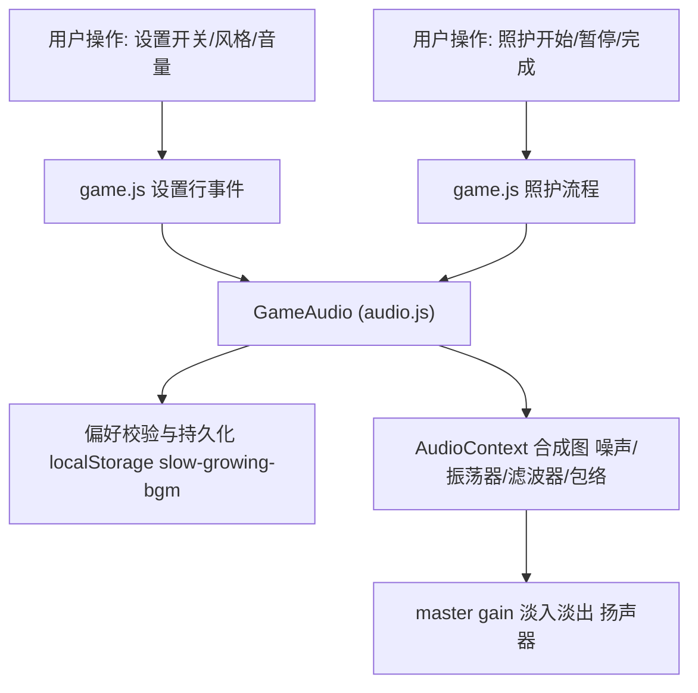

# 氛围背景音乐

Feature Name: ambient-bgm
Updated: 2026-11-01

## Description

为照护操作提供可选背景音景。用户在偏好设置中开启背景音乐后，照护任务进行时播放所选风格（白噪音、雨声、海浪、八音盒轻音乐、森林晨间），暂停或完成时淡出停止。全部声音由 Web Audio API 实时合成，零外部音频文件，规避版权问题。支持音量滑块，偏好持久化到 localStorage。

## Architecture



- `audio.js`：独立模块 `window.GameAudio`，采用与 engine.js 相同的 UMD 工厂模式，可在 Node 中加载纯逻辑部分做单元测试。
- `game.js`：负责调用时机（照护开始播放、暂停/完成停止）与设置页控件渲染。
- `index.html`：在 visuals.js 与 game.js 之间引入 audio.js。

## Components and Interfaces

### GameAudio（audio.js）

| 成员 | 说明 |
| --- | --- |
| `styles` | 音景清单 `[{id,name}]`：white 白噪音、rain 雨声、wave 海浪、music 八音盒、forest 森林晨间 |
| `validatePref(raw)` | 纯函数：校验并归一化偏好对象，非法输入返回默认值 `{enabled:false, style:'rain', volume:0.6}`，volume 钳制到 0–1 |
| `loadPref()` | 从 localStorage 读取并经 validatePref 归一化 |
| `play()` | 若 enabled 为真则启动当前风格合成图（幂等，重复调用无副作用） |
| `stop()` | 约 1 秒淡出并释放节点（幂等） |
| `setEnabled(v)` / `setStyle(id)` / `setVolume(v)` | 更新偏好、持久化；播放中即时生效（风格切换淡出旧、淡入新） |
| `stylesHtml()` | 渲染风格下拉选项字符串，供设置页复用 |

### 合成图（每种音景一个构建函数）

- **白噪音**：白噪声循环缓冲 → 低通 5kHz → 音量 0.18。
- **雨声**：粉噪声 → 高通 400Hz + 低通 1500Hz（增益 0.55），叠加慢速 LFO 音量起伏模拟雨势。
- **海浪**：棕噪声 → 低通 500Hz（增益 0.65），增益由 0.07Hz 正弦 LFO 大深度调制形成涨落。
- **八音盒**：C 大调五声音阶随机游走，三角波 + 正弦泛音，快起音、1.5–2.5 秒指数衰减（峰值 0.22），馈入反馈延迟营造空间感，1.2–2.4 秒间隔调度。
- **森林晨间**：极轻风声（粉噪声低通 400Hz，增益 0.09）+ 随机 2–6 秒间隔的鸟鸣（2–4kHz 频率扫描短音，峰值 0.08，随机声像）。

所有合成图共用一条 `master gain`（映射为 `volume × 0.85`），淡入淡出统一在 master 上做 ramp。八音盒与森林的音符调度链在 AudioContext 处于 suspended 时跳过出音并延时重试，避免恢复播放时时间戳堆积。

音景总线启动与切换采用 `gradualFade`：24 段线性 ramp 按幂函数 2.2 的缓入曲线从 0.0001 渐进抬升，开始播放约 3 秒、中途换风格约 2 秒达到目标音量，起始接近无声。停止仍走 1 秒线性淡出。

### game.js 集成点

- 启动时 `loadPref()`。
- 设置页（renderSecondary 的 settings 分支）新增三行：背景音乐开关、音景风格下拉、音量滑块；change 事件调用对应 setter，写库失败时沿用现有 toast 降级文案。
- 音量滑块采用自定义轨道与拖块样式（`--fill` 变量驱动已填充轨道），并监听 `input` 事件实时更新音量、轨道填充与百分比提示；`.setting-row input` 的 20px 通用规则通过 range 专属规则覆盖，保证移动端可拖动。
- `toggleCare()` 中 `running=true` 后调用 `play()`，并在 1.5 秒后检查 `A.blocked`：若浏览器仍未放行声音则 toast 提示用户轻点屏幕。
- `pause()` 中调用 `stop()`（覆盖切后台、锁屏、关闭弹窗、翻页）。
- `tick()` 照护完成分支调用 `stop()`。

### 移动端解锁与入口

- audio.js 在首次 `pointerdown`/`touchend` 手势时调用 `unlock()`：创建 AudioContext、resume 并播放一个 1 样本静音 buffer（兼容 iOS Safari 与微信/UC 类 WebView 的解锁要求），手势监听在上下文进入 running 前持续生效。
- 偏好设置页的背景音乐行提示 iOS 侧边静音拨片会屏蔽媒体声音。
- 移动端（≤600px）侧栏折叠为底部标签栏时，原生隐藏了 `.settings` 入口；enhancements.css 恢复一个固定于底栏右侧的「偏好设置」项，保证手机上可以到达音乐设置。

## Data Models

localStorage 键 `slow-growing-bgm`，JSON：

```json
{"enabled": false, "style": "rain", "volume": 0.6}
```

- `enabled`：boolean，默认 false。
- `style`：`white|rain|wave|music|forest` 之一，默认 rain。
- `volume`：0–1 数值，默认 0.6，映射到 master gain 为 `volume * 0.5`。

## Correctness Properties

1. 音频出声的充要条件：`enabled === true` 且照护任务处于运行态；任一暂停路径（切后台、锁屏、关闭弹窗、照护完成、页面跳转）在一秒内淡出。
2. `validatePref` 幂等：对任意输入，`validatePref(validatePref(x))` 深等于 `validatePref(x)`。
3. `play()` 与 `stop()` 幂等，重复调用不叠加节点、不泄漏音频节点。
4. 音频任何异常（AudioContext 创建失败、被自动播放策略挂起、合成报错）均被捕获，页面其余功能保持可用。

## Error Handling

- AudioContext 创建或 resume 失败：捕获后置 `ok=false`，本会话静默；开关与偏好照常保存。
- 自动播放策略挂起：`play()` 内先 `resume()`；被拦截时保持偏好不变，用户下次手势触发的播放自动重试。
- localStorage 写入失败：沿用现有模式 catch 后 toast 提示，偏好在本会话内仍生效。

## Test Strategy

- `node --test audio.test.cjs`：styles 清单与 id 唯一性；validatePref 对合法、缺字段、非法 style、越界 volume、非对象输入的行为；幂等性质。
- `browser.test.cjs` 增补：设置页三控件渲染；开关、风格、音量变更写入 localStorage 且刷新后恢复；照护开始与完成过程无 pageerror。
- 手动验证：预览页开启音乐 → 开始喂食 → 听音景 → 暂停/完成确认淡出。

## References

- game.js `toggleCare`/`pause`/`tick`/`renderSecondary`
- engine.js UMD 模式与测试组织方式
