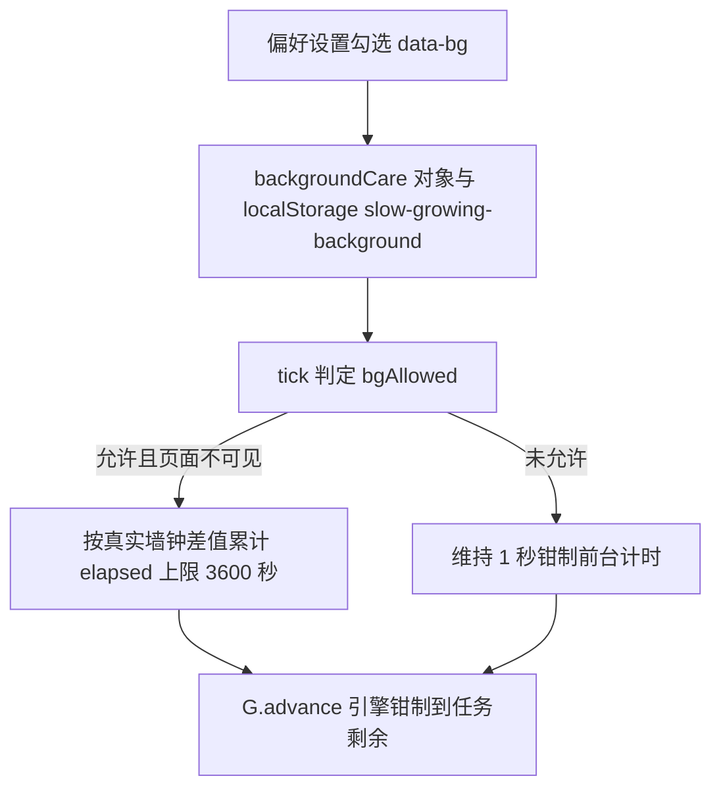

# 后台照护

Feature Name: background-care
Updated: 2026-11-01

## Description

在偏好设置中按操作类型（喂养、清洁、陪伴、休息）允许后台进行。勾选后，页面不可见期间任务按真实墙钟时间继续累计（引擎对超出任务剩余时长的增量自行钳制），恢复可见后立即同步；背景音乐在桌面端后台期间保持播放。关闭弹窗、关闭整页与多标签同步仍按现有规则暂停。

## Architecture

## Components and Interfaces

- **偏好键** `slow-growing-background`：JSON `{food,clean,mood,energy}` 布尔，默认全 false；载入时仅接受四个白名单 id 的布尔值。
- **game.js `tick()`**：`document.hidden` 且 `backgroundCare[state.task.actionId]` 为真时保持运行，elapsed 采用未钳制墙钟差值（单次上限 3600 秒防时钟异常）；其余路径维持每 tick 1 秒钳制。
- **game.js visibilitychange**：隐藏时仅当任务运行且该操作允许后台才跳过 `pause()`；恢复可见时照常 `render()+updateTimer()`。
- **game.js `pagehide`、storage 事件、弹窗 close**：保持 `pause()`。
- **设置 UI**：新增「后台照护」行（四个复选）；「专心陪伴模式」行徽标动态显示 `后台 N 项 / 仅前台`。

## Correctness Properties

1. 出现暂停行为的充要条件：任务运行中且（页面不可见且该操作未允许后台，或照护弹窗被关闭，或页面卸载，或另一标签页写入存档）。
2. 后台累计总量受引擎 `advance` 的 `min(seconds, 剩余)` 钳制，任务完成时刻与真实时间一致。
3. 偏好往返：非法或缺失字段回落为 false，不产生未知键。

## Error Handling

- localStorage 写入失败沿用现有 catch + toast 降级。
- 设备时钟异常（大幅回拨）由 3600 秒单 tick 上限约束。

## Test Strategy

- browser.test.cjs：勾选后台休息 → 开始照护 → 伪造 `document.hidden` → 计时在隐藏期间继续且音乐保持 active → 恢复可见 → 快进完成；取消勾选路径由既有「后台暂停」断言覆盖。
