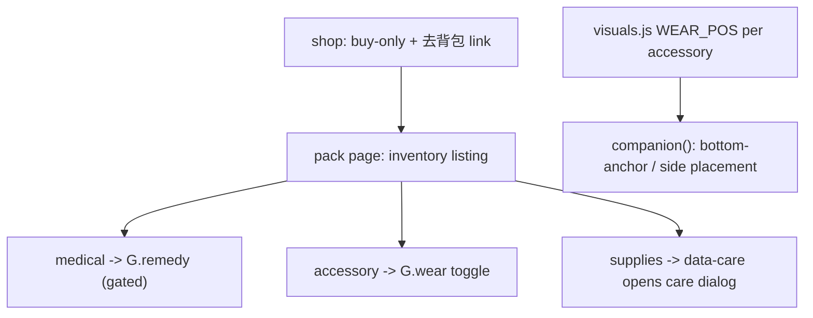

# 背包与饰物穿戴修复

Feature Name: backpack-accessory-fix
Updated: 2026-11-06

## Description

新增「我的背包」页（数据源即存档 inventory，引擎零改动）：照护物资一键去照护、医疗品按门控直接使用、饰物穿上/脱下（非消耗）。小铺移除使用与穿戴按钮改为「去背包」入口。修复 WEAR_POS（当前为空、全部饰物落在角色顶部）：按物品形态定义 16 件饰物的锚点——陶盆底部对齐替换默认花盆、摆件落地旁置、穿戴件对准头颈足。

## Architecture

## Components and Interfaces

- `game.js`
  - `pageNames` 增加 `pack:'我的背包'`；`renderSecondary` 增加 pack 分支：三组列表（supplies/medical/accessory），复用 `data-toolbox`（医疗）、`data-wear`（饰物切换）、`data-care`（物资去照护）现有委托。
  - 小铺分支：medical/acc 已拥有时按钮改为 `data-page="pack"` 链接；删除 remedyOk/remedyLabel 逻辑。
- `visuals.js`
  - `WEAR_POS[type][worn] = { x, y, w, bottom? }`；`companion()` 支持 `bottom:true` 时 `ay = iy + d - ah`（底边对齐角色基线）。
  - 位置定义：植物陶盆底部覆盖；洒水壶/标签牌/小铲落地旁置；猫狗围巾项圈头巾对准颈位、毛线球/绳球/木球/鱼坠落地；宝宝帽子居顶、围兜胸前、学步鞋底部对齐、牙胶落地。
  - 新增背包图标。
- `index.html`：侧边导航插入「我的背包」。
- `enhancements.css`：背包行样式。

## Data Models

- 无新字段：背包即 `state.inventory`，饰物穿戴态即 `state.worn`。

## Correctness Properties

1. 背包列表恒等于 `catalog.filter(id => inventory[id] > 0)` 按类分组。
2. 饰物操作前后 `inventory[acc]` 不变，`worn` 切换。
3. 陶盆渲染底边与角色基线（BASE_Y）对齐。

## Error Handling

- 饰物阶段不足：按钮禁用「成长后解锁」。
- 医疗门控不满足：按钮禁用并说明原因。

## Test Strategy

- 浏览器：小铺买饰物 → 小铺无穿戴按钮 → 背包出现 → 穿戴 → 脱下收回；陶盆穿戴后房间场景中陶盆元素存在；医疗品在背包使用门控。
- 引擎：无改动，回归 44 组。
