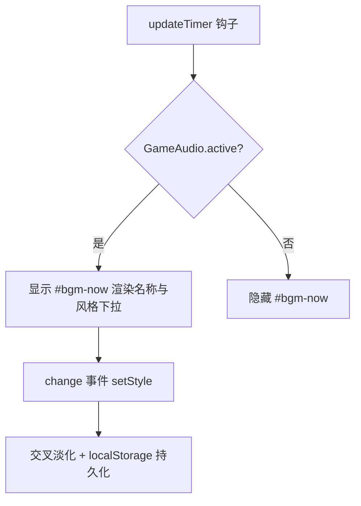

# 照护界面音景展示与即点即换

Feature Name: bgm-now-playing
Updated: 2026-11-01

## Description

照护弹窗新增 `#bgm-now` 行：均衡器动画 + 当前音景名称 + 风格下拉。仅在 `GameAudio.active` 为真时显示；更换风格调用 `GameAudio.setStyle`（播放中自动交叉淡化）并持久化。偏好设置仍是完整配置入口。

## Architecture

## Components and Interfaces

- `index.html`：care-dialog 内 `#care-products` 之后插入 `#bgm-now`（默认 hidden）。
- `game.js renderBgmNow()`：仅当显示状态或风格变化时写 DOM（tick 每 250ms 调用 updateTimer，避免重复 innerHTML）；在 `updateTimer()` 顶部调用。
- change 事件 `bgm-now-style`：`A.setStyle` → 失败 toast 降级 → 重渲染行。
- CSS（enhancements.css）：`.bgm-now` 行样式与 `.bgm-eq` 三柱缩放动画；动画受全局 `prefers-reduced-motion` 规则约束。

## Correctness Properties

1. `#bgm-now` 可见的充要条件：照护弹窗打开且 `GameAudio.active` 为真。
2. 弹窗内更换风格后，`slow-growing-bgm.style` 与下拉选中项一致。
3. 名称渲染与偏好状态最终一致（下一个 updateTimer 周期内收敛）。

## Error Handling

- setStyle 存储失败沿用 toast 降级，会话内仍生效。
- 音频异常静默时 `active` 为假，展示区保持隐藏。

## Test Strategy

- browser.test.cjs：开启背景音乐开始照护 → `#bgm-now` 可见且名称匹配 → 下拉切换 → 名称与存储更新 → 照护完成后隐藏。
