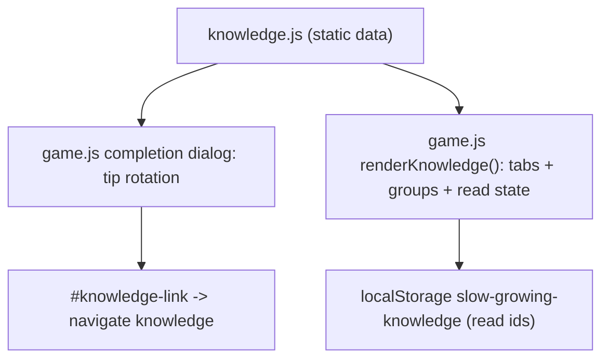

# 养育课堂（照护知识科普）

Feature Name: care-knowledge
Updated: 2026-11-06

## Description

新增 `knowledge.js` 静态知识模块（四角色 × 四分类，每分类 3 条共 48 条）；照护完成弹窗按「角色 + 动作分类」轮换推送知识；侧边导航新增「养育课堂」页签，按角色分页、分类分组、可展开阅读并持久化已读进度。

## Architecture

## Components and Interfaces

- `knowledge.js`（新文件，`window.GameKnowledge`）
  - `categories = { food: '喂养营养', clean: '清洁护理', mood: '情感陪伴', energy: '健康与观察' }`
  - `topics = { baby: [...], cat: [...], dog: [...], plant: [...] }`，条目 `{ id, cat, title, body }`，每角色每分类 3 条，共 48 条。
- `game.js`
  - 完成弹窗：`tipCursor[actionId]` 轮换取 `topics[role].filter(t => t.cat === actionId)`；池空则隐藏；新增 `#knowledge-link` 按钮（关闭弹窗并导航）。
  - `renderKnowledge()`：角色页签 `data-krole`（默认当前角色）、分类分组、卡片展开 `data-ktoggle`（展开即标记已读）、进度胶囊。
  - 已读存 localStorage `slow-growing-knowledge`（id 数组）。
- `index.html`：侧边导航插入「养育课堂」按钮；底部引入 `knowledge.js`。
- `visuals.js`：新增 bulb 图标。
- `enhancements.css`：页签、知识卡、提示框样式。

## Data Models

- 条目 `{ id: 'cat-feed-1', cat: 'food', title, body }`；已读持久化为 id 数组。

## Correctness Properties

1. 知识池相邻两次推送取不同条目（池长 ≥2 时）。
2. 已读集合刷新后保持。
3. 知识渲染路径无用户输入，无 XSS 面；运行期零外部请求。

## Error Handling

- localStorage 不可用：已读状态降级为会话内有效。
- 池为空 / 长度 1：隐藏提示或允许重复，弹窗功能不受影响。

## Test Strategy

- 浏览器：导航与页签、展开标记已读并刷新保留、完成弹窗含小知识与跳转入口。
- 引擎：无改动，回归 44 组保持绿。
