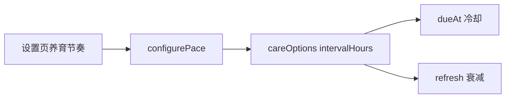

# 养育节奏档位

Feature Name: care-pace
Updated: 2026-11-11

## Description

设置页增加紧致 / 正常 / 宽松三档。引擎用倍率缩放四项 `intervalHours`，冷却与需求衰减共用该值。默认正常，偏好存在 `slow-growing-pace`，与存档分离。

## Architecture

倍率：紧致 0.75、正常 1、宽松 1.5。照护任务秒数不缩放。正常档四项间隔约 3–6 小时，彼此略有差别。

## Components and Interfaces

- `configurePace(id)`：校验 `tight` / `normal` / `relaxed`，写入模块状态。
- `stage().feedHours` / `cleanHours`：基础小时乘倍率。
- `careOptions`：心情 3.5 小时、精力 4 小时同样乘倍率。
- 设置页：`#care-pace` 下拉，文案说明间隔与需求下降会一起变。
- 本地存储键：`slow-growing-pace`，值为档位 id。

## Data Models

节奏不写入 v2 存档。非法值回退到 `normal`。

## Correctness Properties

- 默认档下猫/狗/植物 `careOptions` 间隔为喂养 3、清洁 5、心情 3.5、精力 4；宝宝清洁 4.5。
- 宽松档喂养间隔为正常档的 1.5 倍；1 小时衰减量为正常档的 2/3。
- 紧致档喂养间隔为正常档的 0.75 倍。
- `configurePace` 拒绝未知 id。

## Error Handling

- 非法档位：引擎抛错；界面保持上一档并提示。
- 本地存储写入失败：本次会话仍生效。

## Test Strategy

- engine.test.cjs：默认间隔；紧致 / 宽松缩放冷却与衰减；非法值拒绝；测试结束恢复 normal。
- browser.test.cjs：设置页可选宽松，刷新后仍为宽松。

## References

[^1]: (Filename) - engine.js careOptions refresh
[^2]: (Filename) - .monkeycode/specs/care-pace/requirements.md
