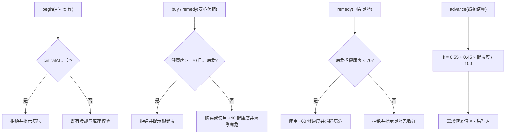

# 病危照护封锁与健康度收益系数

Feature Name: critical-lock-health-yield
Updated: 2026-11-13

## Description

修正健康系统三处行为：病危（`criticalAt !== null`）时封锁全部照护动作的开始；安心药箱与回春灵药均可在健康度低于 70 或病危时购买与使用，按恢复量与价格分级（+40 / +60），角色离开或死亡后无法再用药挽救；照护结算的需求恢复值乘以线性健康度系数 `k = 0.55 + 0.45 × 健康度 / 100`（健康 100 时 1.0，健康 0 时 0.55），作为游戏内在难度，不新增存档字段与设置项。

## Architecture

## Components and Interfaces

- `engine.js begin()`：在「已离开」校验之后、任务校验之前新增病危拦截，返回 `${petName}病危了，先用安心药箱或回春灵药挽回`。
- `engine.js buy()`：安心药箱购买条件为「健康度 ≥ 70 且非病危时拒绝」。
- `engine.js remedy()`：安心药箱分支在病危时同样可用，使用后 +40 健康度并清除病危计时；回春灵药分支不变。
- `engine.js advance()`：需求恢复值由 `gain` 改为 `gain × k`，k 按结算时刻健康度实时计算；经验、亲密度、积分、+2 健康度规则不变。
- `game.js` 工具箱与背包页：两种药品「使用」按钮可用条件统一为 `health < 70 || criticalAt !== null`。

## Data Models

无新增存档字段。k 为结算期派生量，`criticalAt`、`health` 均为既有字段。系数取值范围 `[0.55, 1.0]`。

## Correctness Properties

- 病危 ⇒ `begin` 四类动作均拒绝，`buy/remedy(安心药箱)` 与 `remedy(回春灵药)` 均可用。
- 任一药品解除病危后，照护动作立即恢复可用。
- 进行中的任务不受封锁影响，完成时按结算时刻健康度的 k 折算。
- k 随健康度连续线性变化，健康度 100 时不改变既有收益数值。

## Error Handling

所有拒绝路径返回中文提示文案（与「太虚弱了，先照顾好身体」同一语气），不抛异常、不改状态；界面以 toast 展示引擎返回值，药品按钮以 disabled 呈现不可用。

## Test Strategy

- 病危时 `begin` 四类动作均被拒绝且任务/库存/需求不变。
- 病危时购买与使用安心药箱成功，健康度 +40、`criticalAt` 清空、库存减一。
- 回春灵药解除病危后健康度 60、`criticalAt` 清空、照护恢复可用。
- 健康度 100 时 k=1（需求 +45 精确成立），健康度 20 时 k=0.64（45×0.64），病危结算 k=0.55。
- 既有药品测试（680-699 行）与短时事件测试保持绿。

## References

[^1]: (engine.js#L513) — begin 动作入口
[^2]: (engine.js#L596) — buy 购买入口
[^3]: (engine.js#L655) — remedy 药品使用入口
[^4]: (engine.js#L545) — advance 结算入口
[^5]: (game.js#L223) — 工具箱药品按钮
[^6]: (game.js#L269) — 背包页药品按钮
[^7]: (.monkeycode/specs/health-sickness-system/requirements.md) — 既有健康规格，本特性同步修订其 Requirement 2 第 4 条与 Requirement 3 第 1 条
