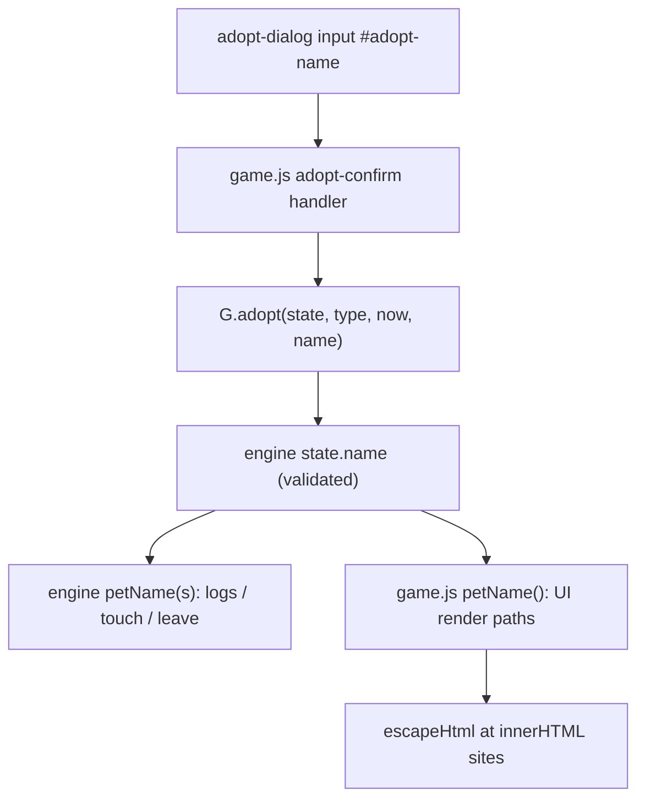

# 自定义角色名字（领养时命名）

Feature Name: custom-pet-name
Updated: 2026-11-05

## Description

领养弹窗新增名字输入框；名字作为存档可选字段 `name` 保存，引擎与 UI 全链路使用自定义名字，留空回退默认名。

## Architecture

## Components and Interfaces

- `engine.js`
  - `create()` 增加 `name: null`。
  - `validate()`：`name` 可选；非 null 时断言 string 且 1–12 字符。
  - `load()`：旧档缺字段迁移为 `null`。
  - `adopt(s, type, now, name)`：第 4 可选参；trim 后非空则写入，超长抛 TypeError。
  - 新增 `petName(s)`：`s.name || profiles[s.selected].name`，导出；替换 adopt/rewardEmotions/refresh 病危日志/leave/remedy/touch（baby 分支）中的 `profiles[...].name`。
- `game.js`
  - 新增 `petName()` 助手 = `state.name || profile().name`。
  - innerHTML 路径（companion-chip、bond-card emotion()、critical-banner、memorial）统一 `escapeHtml(petName())`；textContent 路径直接赋值。
  - `renderAdoption()` 更新输入框占位文案；领养确认读取输入值传入引擎；重启时清空输入框。
- `index.html`：adopt-dialog 在 `#adopt-options` 与 `#adopt-summary` 之间插入 `<input id="adopt-name" maxlength="12">`。
- `enhancements.css`：输入框样式。

## Data Models

- 存档新增可选字段 `name: string | null`；v2 校验放宽接受该字段；缺省迁移 null。

## Correctness Properties

1. `validate` 后 `s.name` 恒为 null 或长度 1–12 的非空字符串。
2. `petName(s)` 对任何已领养存档返回非空名字。
3. 名字写入的所有 innerHTML 输出均经 escapeHtml。

## Error Handling

- 名字超长 / 非字符串：引擎 assert 抛 TypeError；UI 由 maxlength 预防，异常走领养确认已有的 try/catch toast。
- 旧档无字段：load 迁移 null。

## Test Strategy

- 引擎：带名领养（含空白 trim）、无名回退、超长拒绝、旧档迁移、日志使用自定义名、petName 导出。
- 浏览器：输入自定义名领养 → 名牌/存档/重载一致；留空领养 → 默认名。
