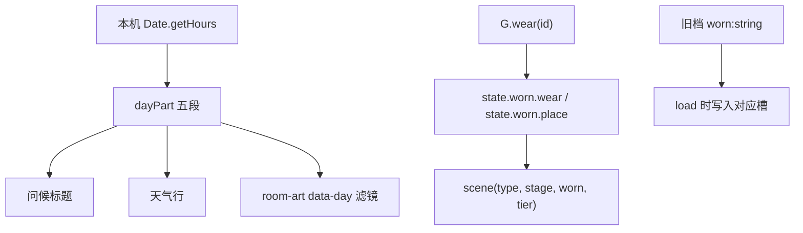

# 日子纹理与双槽饰物

Feature Name: day-texture-dual-slots
Updated: 2026-11-08

## Description

本机时钟驱动主页问候、天气行与房间滤镜；引擎 `worn` 从单字符串改为 `{ wear, place }` 两槽，旧档字符串按槽位表迁移。大模型对话不在本设计内。

## Architecture

## Components and Interfaces

- `engine.js`
  - `ACC_SLOT`：16 件饰物到 `wear` / `place` 的固定映射。
  - `worn` 形态：`{ wear: string|null, place: string|null }`。
  - `wear(s, id, now)`：`id === null` 清空两槽；否则只切换 `ACC_SLOT[id]` 对应槽。
  - `accessorySlot(id)` 导出给界面。
  - `load`：字符串 `worn` 迁入对应槽；缺省补 `{ wear:null, place:null }`。
- `visuals.js`
  - `scene` / `companion` 接受字符串（单件，测试兼容）或两槽对象。
  - 绘制顺序：地影 → 陶盆（若在摆放槽）→ 植株 → 其余摆放件 → 穿戴件。
- `game.js`
  - `dayPart()`、问候表、天气表；`render()` 写 `#greeting-title`、`.room-weather`、`#room-art dataset.day`。
  - 安心气泡按时段换句。
  - 背包按钮文案按槽位区分穿上/放下。
  - `sceneKey` 含两槽 id，避免漏重绘。
- `enhancements.css`：`.room-art[data-day=...] .room-bg` 滤镜。

## Data Models

穿戴槽：`acc-baby-1/2/3`、`acc-cat-1/2`、`acc-dog-1/2`。

摆放槽：`acc-baby-4`、`acc-cat-3/4`、`acc-dog-3/4`、`acc-plant-1/2/3/4`。

植物四件均在摆放槽，彼此仍互斥；叶纹陶盆待分层素材后再升为独立 base 槽。

时段（当地小时，含起点，含终点前一小时）：

- 清晨 6–10：问候「新的一天，先看看它」；天气「清晨的微光 · 18°C」
- 正午 11–13：「午后的小屋，也要好好陪伴」；「阳光正好 · 24°C」
- 午后 14–17：「阳光正好，慢慢待一会儿」；「温暖的午后 · 24°C」
- 傍晚 18–21：「傍晚回来了，它在等你」；「暮色渐沉 · 20°C」
- 夜里 22–5：「夜深了，轻轻陪一会儿」；「夜里的小屋 · 16°C」

## Correctness Properties

1. 同一小时映射到唯一时段。
2. 穿戴槽与摆放槽可同时非空，且属于不同饰物。
3. 切换同槽饰物时另一槽 id 不变。
4. 脱下后 `inventory[id]` 不变。
5. 旧档字符串 `worn` 载入后出现在正确槽位。

## Error Handling

- 未拥有 / 未适龄 / 类型不符：`wear` 返回既有中文提示。
- 损坏的 `worn` 对象：校验失败，走既有存档损坏提示。
- 时钟回拨：问候用 `Date.now()` 的当地小时，与引擎 `now()` 钳制互不影响。

## Test Strategy

- 引擎：两槽互不干扰、同槽替换、字符串迁移、领养清空。
- visuals：对象形态同时输出两个 `data-worn`；字符串形态仍可用；陶盆仍无 clipPath、仍在植株之后。
- 浏览器：帽子 + 牙胶同时出现在房间；问候标题匹配五段文案之一；天气行含温度口吻。
