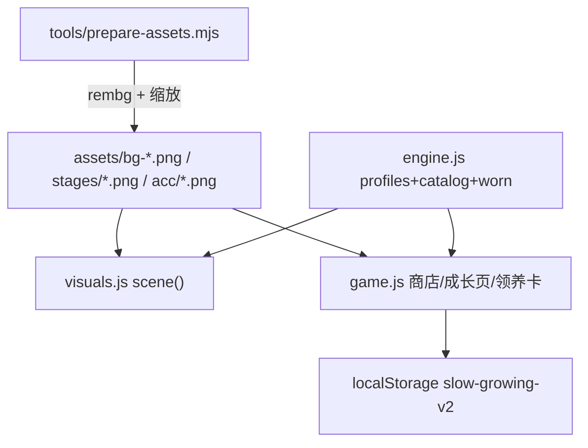

# 设计包美术深度优化 — 技术设计

Feature Name: design-pack-integration
Updated: 2026-11-03

## Description

接入设计包美术与第 4 角色 plant：引擎档案/阶段名/照护语义扩展，房间场景改为「整幅背景 + 阶段立绘 + 饰物叠加」，商店新增饰物类目与穿戴系统，成长路径页展示阶段图鉴。原生 JS 无构建，沿用 UMD 模块与 localStorage 存档。

## Architecture

## Components and Interfaces

### engine.js

1. `profiles` 扩为 4 项并改名：baby 阿团 / cat 橘汐 / dog 麦芽 / plant 团子（kind: 宝宝/小猫/小狗/小植物）。
2. 新增 `STAGE_LABELS`（按类型 4 阶段名），`stageName(type,index)` 改查该表；`milestones()` 沿用其输出。目录商品命名保留通用阶段词（初生/探索/成长/成年），降低改动面。
3. 新增 `CARE_META`：按类型返回 4 动作名与 4 需求标签。plant：浇水/擦叶除虫/晒太阳/施肥 + 水分/洁净/阳光/养分；baby/cat/dog 沿用现文案。`careOptions(s)` 每项追加 `need` 字段（需求标签）。施肥语义见 plant-fertilize-nutrients。
4. `profiles.plant` 触摸回应与 `emotion()`（game.js）补 plant 文案；所有硬编码角色名（如 baby 回应里的「小满」）改为引用 `profiles` 名称。
5. 目录追加 16 件饰物：`acc-{type}-{1..4}`，category `accessory`，pack 1，price 30/45/60/80，minStage 1/2/2/3，icon 复用 spark/heart；name/description 取自设计包饰物清单。
6. 状态新增 `worn`（string|null，默认 null）：`create()` 初始化；`validate()` 校验 `worn === null || (饰物存在 && types.includes(selected) && inventory[worn] > 0)`。
7. 新增 `wear(s, id, now)`：refresh 后校验已领养、id 在目录且 category=accessory、types 匹配、minStage ≤ 当前阶段、inventory>0；重复穿戴同件=脱下；成功返回 null，失败返回中文原因。`relief()`、`buy()` 不受影响（饰物走 buy 扣积分）。

### visuals.js

1. `scene(type, stageIndex, worn)`：
   - 背景层：`<image href="assets/bg-{type}.png" width=620 height=362 preserveAspectRatio="xMidYMid slice">`（bg 为 JPEG 无透明，slice 裁切铺满）。
   - 立绘层：`<image class="pet-breathe" data-character data-stage="{stageIndex}" href="assets/stages/{type}-{n}.png">`，按每类型尺寸表定位（立绘高度约 150–200 viewBox 单位，中心 x≈312，底 y≈316），下方保留椭圆地影。
   - 饰物层：worn 非空时叠加 `<image class="acc-worn" data-worn="{id}">`，位置查 `WEAR_POS[type][itemId]` 表（相对立绘盒的百分比坐标，初始以成年期立绘目测标定，再按截图微调）。
   - 保留 hearts 与 aria-label；删除原 SVG 家具/窗/地毯绘制与 `props()`。
2. `portrait(type)`：改用 `assets/stages/{type}-1.png`（object-fit cover 由 CSS 控制）。
3. 场景 SVG 增加 `<rect>` 兜底底色（各类型取自 bible 背景主色），图片加载失败时场景仍可读。

### game.js

1. 场景重渲染：维护 `sceneKey = type + ':' + stageIndex + ':' + (state.worn||'')`，render() 中与 `room-art` 当前 key 比对（存于 dataset），变化才重写 innerHTML（避免每 15s 重排触发动画重置）。
2. 需求标签：`labels` 数组改为 `actions.map(a=>a.need)`。
3. 商店：categories 增加 `accessory:'随身饰物'`；饰物卡按钮双态——未拥有显示「N 积分 · 兑换」走 buy；已拥有显示「穿戴中/穿戴」/「脱下」走 wear，禁用条件含 minStage。
4. 成长页：里程碑卡内嵌 `` 缩略图。
5. `emotion()` 与触摸文案补 plant；baby 文案中「小满」替换为档案名。
6. 领养卡片 small 文案补 plant（「安静的盆栽，从破土到盛放」）。

### assets 管线（一次性脚本 tools/prepare-assets.mjs，不入运行时）

1. 背景图：design-pack `bg-*.png` → PIL 缩放至宽 1600 → JPEG q85 → `assets/bg-{type}.jpg`（SVG image href 用 .jpg）。
2. 阶段图：`stages/{type}-{n}.png` → rembg(u2net) 抠图 → 高度 ≤720 PNG → `assets/stages/{type}-{n}.png`。
3. 饰物图：`acc-{type}.png` 用 PIL 均分 4 格（784×1344）→ 逐格 rembg → 高度 ≤560 PNG → `assets/acc/{type}-{n}.png`。
4. 体积预算（R8）：生成后统计，超出则再降一档尺寸。
5. 旧图 `assets/{type}-{gen,card,room}.png` 保留在仓库（历史资产，不再引用）。

## Data Models

- 存档 v2 新增字段：`worn: null | "acc-{type}-{n}"`。validate 白名单校验；旧档缺字段视为 null（load 后 JSON 深拷贝补默认值）。
- `inventory[accId] > 0` 即视为已拥有（与现有库存模型一致，pack=1）。

## Correctness Properties

1. `worn` 为 null 或「已拥有 + 适龄 + 属于当前类型」的饰物 id（validate 强制）。
2. 穿戴操作不改积分、不写库存；购买才扣积分。
3. 场景 DOM 的 data-character/data-stage 与 state.selected/state 阶段一致。
4. 同一 actionId 的照护时长、冷却、收益与现版本完全一致（plant 仅改名称与文案）。
5. 旧 v2 档 load 后除新增 `worn=null` 外无其他字段差异。

## Error Handling

- 抠图失败（rembg 对水彩柔边偶发破洞）：对失败图改用 isnet-general-use 重跑；仍失败则人工降级（保留柔光底、以圆角卡片形式展示立绘）。
- 饰物位置表缺失：回退到立绘盒中上默认位（x=50%, y=8%），保证可穿戴可见。
- 图片 404：SVG `<image>` 无 onerror 钩子，依赖兜底底色保证可读性；测试中用 onerror 断言资源路径存在。

## Test Strategy

- engine.test.cjs：plant 领养/照护/购买全流程；阶段名按类型断言；wear 成功/未拥有/未适龄/替换/脱下；validate 对 worn 的接受与拒绝。
- visuals.test.cjs：scene 含 bg image、data-stage、worn 叠加层；portrait 指向 stage-1；plant 场景可生成。
- browser.test.cjs：领养第 4 卡（plant）→ 领养 → 商店买饰物 → 穿戴 → 房间出现 data-worn；成长页出现阶段图与「篮中小猫」等每类型名。
- 截图核对：Playwright 对 4 类型房间、商店饰物卡、成长页各截一张，人工比对设计包。

## References

- 设计包：`/tmp/opencode/design-pack/`（character-design-bible.html、assets/、tools/png-slice.js）
- 现有规格：`.monkeycode/specs/lifelike-care-v2/`、`.monkeycode/specs/ambient-bgm/`、`.monkeycode/specs/background-care/`
- 引擎状态契约：`engine.js:83-134`（validate）、`engine.js:21-59`（profiles/catalog）
