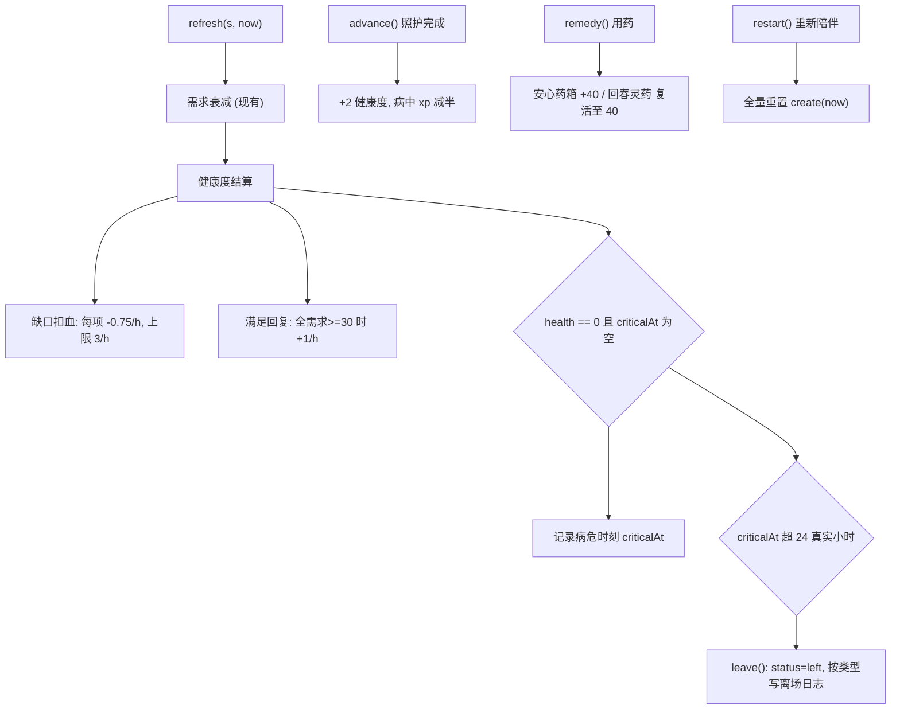

# 健康与生病系统 技术设计

Feature Name: health-sickness-system
Updated: 2026-11-04

## Description

在现有真实时间驱动的需求衰减之上叠加健康度（血条）层：需求长期触底导致健康度流失，照护良好则回升。健康度分级（萎靡/生病/病重）带来渐进影响，归零进入 24 小时病危宽限期，可用回春灵药复活；超时角色按类型叙事永久离开，留念面板展示陪伴履历后可重新领养。全部数值沿用现有 elapsed-based 刷新管线，保证离线一致性与幂等。

## Architecture



- `refresh()` 是唯一的时间结算入口：健康度扣减/回复与需求衰减共用同一段 elapsed hours，天然幂等（同一时刻二次刷新 hours=0）。
- 病危判定与离开判定都在 `refresh()` 内完成，离线超时同样生效。
- UI 渲染以 `sceneKey = type:index:worn:tier` 驱动房间重绘，tier ∈ alive-healthy/alive-low/alive-sick/alive-critical/left。

## Components and Interfaces

### engine.js

| 成员 | 变更 |
|------|------|
| `create(now)` | 新增 `health: 100, status: 'alive', criticalAt: null, leftAt: null` |
| `validate(s)` | 校验 health∈[0,100] 数值；status∈{alive,left}；left ⇒ criticalAt/leftAt 为合法时间且 ≤ updated；alive ⇒ leftAt 为空；criticalAt ≤ updated |
| `load(s)` | 补默认：无 health ⇒ 100/alive/null/null（旧 v2 存档不受影响） |
| `refresh(s, now)` | 需求衰减后结算健康度（见上图），触发病危记录与离开 |
| `stage(s)` | 不变（年龄照常推进，生病靠 xp 减半自然放缓晋级） |
| `advance(s,...)` | 完成时 `health = min(100, health + 2)`；`health < 40` 时 xp 由 10 改为 5 |
| `begin(s, actionId, ...)` | `status==='left'` ⇒ 拒绝；`health < 20` 且 actionId==='mood' ⇒ "太虚弱了，先照顾好身体" |
| `touch(s, ...)` | left ⇒ 拒绝；`health < 20` ⇒ "太虚弱了，先照顾好身体" |
| `remedy(s, id, now)`（新增导出） | 安心药箱：alive、health<70、有库存 ⇒ +40（上限 100）；回春灵药：criticalAt 存在且未超时 ⇒ health=40、criticalAt=null；否则返回提示；扣库存写日志 |
| `buy(s, id, now)` | medicine-kit 且 health≥70 ⇒ "角色很健康，暂不需要药箱"；回春灵药随时可囤 |
| `catalog` | 新增 `medicine-kit`（安心药箱 25 分）、`revive-elixir`（回春灵药 60 分），category `medical`、types 全部、minStage 0、pack 1 |
| `available(s, p)` | medical 类目恒可用（领养后不限阶段） |
| `checkin/buy/wear/relief` | left ⇒ 统一拒绝"角色已经离开" |
| `restart(s, now)`（新增导出） | 仅 status==='left' 可调用；`Object.assign(s, create(now))` 后记录新日志 |
| `departure 离场文案` | baby：被家人接到远方照顾；cat/dog：趁夜色出门远行；plant：花朵枯萎，化作春泥 |
| `sceneMeta(s)`（新增纯函数） | 返回 tier 标识供 UI/sceneKey 使用：left / critical(<20 或病危) / sick(<40) / low(<70) / healthy |

### game.js

- 状态卡新增健康度血条（`#health-fill` + `#health-value`），tier 映射颜色 class。
- 房间区：生病/病重角标（复用立绘 + CSS 降饱和滤镜）、病危横幅（倒计时 + 复活按钮，按钮先 `buy` 后 `remedy`，积分不足走 toast）。
- 离开状态：`renderRoom` 渲染留念面板（陪伴天数/最终阶段/亲密度/最近日志 6 条 + 开始新的陪伴按钮 → `restart()` 后打开领养弹窗）。
- 商店筛选新增"医疗照护"页签；药箱卡在 health≥70 时按钮禁用态提示。
- `sceneKey` 追加 tier；import/save、storage 处理器同步清空 dataset（沿用现有两处清理点）。

### visuals.js

- `scene(type, stageIndex, worn, tier)`：tier 为 sick/critical 时给 `.pet-sprite` 加 data-sick（CSS `filter: saturate(.55) brightness(.96)`）；tier 为 left 时由 game.js 渲染留念 DOM，替代场景调用。

## Data Models

```js
// create(now) 新增字段
{ health: 100, status: 'alive', criticalAt: null, leftAt: null }

// catalog 新增
{ id: 'medicine-kit',  name: '安心药箱', types: [四类], category: 'medical', minStage: 0, price: 25, pack: 1, gain: null, description: '健康低于 70 时使用，恢复 40 健康度。' }
{ id: 'revive-elixir', name: '回春灵药', types: [四类], category: 'medical', minStage: 0, price: 60, pack: 1, gain: null, description: '病危宽限期内使用，恢复至 40 健康度。' }
```

## Correctness Properties

1. 健康度恒在 [0, 100]；变化仅由 elapsed 时间、照护完成、用药三种途径驱动。
2. 同一时刻重复调用 `refresh` 结果不变（hours=0 短路）。
3. `status` 一旦为 left，仅 `restart` 可回到未领养态；任何期间内 `leftAt`/`criticalAt` ≤ `updated`。
4. 健康度 0 ⇒ criticalAt 必被记录；复活 ⇒ criticalAt 清空；再次归零重新计时。
5. 旧版 v2 存档载入后健康度为 100，且不回写损坏值。
6. 病危超时在离线期间同样判定（refresh 内完成，无前台依赖）。

## Error Handling

| 场景 | 处理 |
|------|------|
| 存档 health 非数值/越界 | validate 抛错 → 现有 strict corrupt-save 提示路径 |
| 积分不足买药 | buy 返回"积分不足" → toast |
| 健康时用药/未病危用灵药 | remedy 返回对应提示，扣减库存 |
| 病重时触摸/玩耍 | 引擎拒绝并返回"太虚弱了，先照顾好身体" |
| 离开后调用任意动作 | 引擎统一拒绝，UI 仅剩留念面板 |

## Test Strategy

- **engine.test.cjs** 新增分组：缺口扣血与 3/h 上限、满足回复与照护 +2、三级状态影响（xp 减半/病重禁触摸禁 mood、喂养可用）、药箱购买门槛与 +40、灵药宽限窗口与复活清计时、24h 离场与按类型日志、留念与 restart 重置、旧档默认与损坏拒绝、幂等（同刻二次 refresh）。
- **browser.test.cjs** 注入低健康存档 → 血条红色与病重角标；商店医疗页签购买药箱 → 使用恢复；注入 left 存档 → 留念面板 → 重新领养全流程。
- 现有 29+8+全量 browser 回归必须保持通过。

## References

[^1]: (Filename#L231) — engine.js `refresh()` 现有 elapsed 结算入口
[^2]: (Filename#L305) — engine.js `advance()` 照护完成收益点
[^3]: (Filename#L182) — engine.js `create()` 状态初始化点
