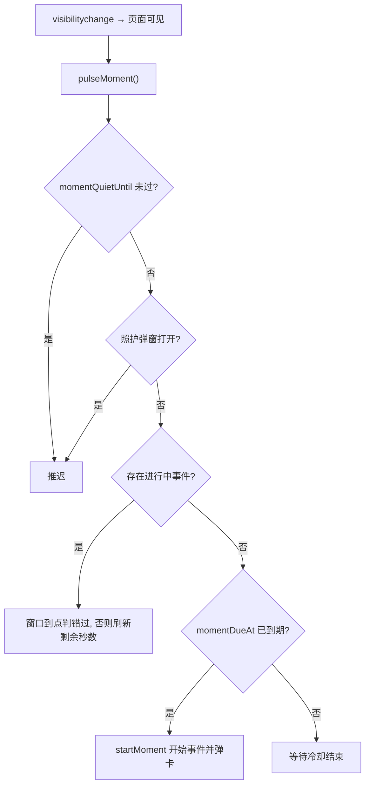

# 短时小事件回归弹窗

Feature Name: moment-return-popup
Updated: 2026-11-12

## Description

短时小事件的 10 秒回应窗口在养育者离开窗口时无法被看到。本特性在页面从隐藏切换为可见的瞬间，对已到期事件主动弹出事件卡片（全新 10 秒窗口），让养育者回到游戏即可及时处置；离开期间正在进行中的事件维持现行静默顺延规则，不奖不罚。

## Architecture

## Components and Interfaces

- `game.js`：既有 `visibilitychange` 监听（game.js#721）的可见分支追加 `pulseMoment()`，页面由隐藏转为可见时立即结算到期事件，复用其全部门槛（静默冷却、照护弹窗、角色门槛）与渲染路径。
- `engine.js`：无改动。`momentDueAt` 已持久化，`startMoment` 的到期判定与重新冷却天然支持回归补弹。
- 事件卡片复用 `moment-card` DOM 与 `renderMoment()`，文案、按钮、剩余秒数与页面内弹出完全一致。

## Data Models

无新增存档字段。回归弹窗是 `momentDueAt`（既有持久化字段）在可见性事件上的新消费路径。

## Correctness Properties

- 离开窗口期间进行管理中的事件：后台刻度触发 `deferMoment`，亲密度不变并重新冷却，回归时不追罚。
- 离开期间陆续到期的多个事件：回归时 `pulseMoment` 只开始一个事件，其余按冷却自然顺延。
- 回归时照护弹窗打开或静默冷却未结束：弹窗推迟，门槛与页面内弹出一致。
- 后台标签页定时器被节流：弹窗不依赖后台刻度，只依赖可见性切换事件。

## Error Handling

- 回归时角色已离开或为小植物：`pulseMoment` 内部门槛直接返回，不弹窗。
- 可见性事件在存档未载入前触发：`pulseMoment` 读取 `state` 前已有既有保护，按未到期处理。

## Test Strategy

- `browser.test.cjs`：领养猫后把 `state.momentDueAt` 回拨到过去，`dispatchEvent(new Event('visibilitychange'))`，断言 `#moment-card` 可见且含剩余秒数；点击 `#moment-hit` 断言亲密度 +2 与日记写入。
- 既有短时事件用例（弹出、点到、错过、顺延）继续通过，确认回归弹窗未改变页面内行为。

## References

[^1]: (game.js#369) — `pulseMoment` 的隐藏顺延分支，回归路径复用同一函数
[^2]: (engine.js#747) — `startMoment` 到期判定与冷却排程
[^3]: (.monkeycode/specs/short-moments/requirements.md) — 短时小事件既有规格
