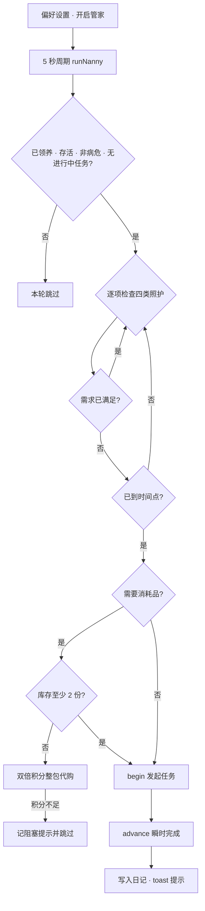

# 贴心管家托管

Feature Name: nanny-care
Updated: 2026-11-13

## Description

新增"贴心管家"托管模式：偏好设置中一键开启，系统在照护到点或需求指标跌破 30 时自动发起并瞬时完成照护；托管消耗两倍物资，库存不足时按双倍积分整包代购。角色病危、已离开或已有手动任务进行中时托管挂起，不绕过任何既有规则。

## Architecture

## Components and Interfaces

- `engine.js nanny(s, now)`：托管核心。内部循环最多四轮，每轮找出第一个满足触发条件的动作：跳过已满足（进食 ≥ 80、其余 ≥ 95）；触发条件为 `now >= dueAt`，需求低于 35 时由既有的 1 分钟加急冷却兜底；需要消耗品的动作优先选库存充足的商品，库存不足 2 份时按 `price × 2` 积分买入一整包并写代购日志，积分不足则记阻塞提示；随后 `begin` 发起标准单份任务、额外扣 1 份物资作为双倍消耗、`advance` 瞬时完成。返回 `{ cared: [{name, message}], blocked }`。
- `game.js runNanny()`：托管调度。读取开关与角色状态后调用 `G.nanny`，有照料时 `save()` + toast + `render()`；每 5 秒执行一次，页面加载后立即执行一次。
- `game.js` 偏好设置新增"贴心管家"开关行（`#nanny-enabled`），偏好以 `slow-growing-nanny` 键持久化，模式与 `slow-growing-background` 一致。
- `index.html` 小屋工具栏新增 `#nanny-chip` 托管中状态按钮，点击即停止托管。

## Data Models

无新增存档字段。托管开关为浏览器本地偏好（`slow-growing-nanny`），引擎状态不感知托管身份；双倍消耗在 `nanny()` 内完成（`begin` 扣 1 份 + 额外扣 1 份），不改变任务结构。

## Correctness Properties

- 触发条件与手动照护完全一致（`dueAt` 到期）；需求低于 30 时借助既有的加急冷却（1 分钟内到期）作为安全网；已满足的动作永不触发。
- 病危、已离开、手动任务进行中：托管完全挂起，不产生任何状态变更。
- 双倍消耗只作用于有消耗品的的动作；陪伴/晒太阳零额外消耗。
- 每轮托管按动作依次结算，完成后的效果、成长、亲密度、积分与手动单份照护完全一致。
- 代购一包后库存增加 `pack` 份，再消耗 2 份，积分扣 `price × 2`。

## Error Handling

- 积分不足时跳过当前动作并记录阻塞提示，不抛异常、不改动状态；下一轮检查自动重试。
- 本地存储异常时托管开关仅本次会话生效，与既有偏好处理一致。
- 代购必然成功后才发起照护，不存在"买了物资但照护失败"的中间态。

## Test Strategy

- `engine.test.cjs`：到点触发并双倍消耗、需求低于 30 触发、已满足跳过、冷却中跳过、病危/离开/任务中挂起、无消耗动作零额外消耗、代购双倍积分、积分不足阻塞。
- `browser.test.cjs`：设置开关持久化、小屋状态按钮可见、强制到点后 `runNanny()` 瞬时完成照料并消耗双倍物资、点击状态按钮停止托管。

## References

[^1]: (engine.js#careOptions) — dueAt 与满足阈值的既有定义
[^2]: (engine.js#begin) — 单份任务发起与消耗扣减
[^3]: (game.js#runNanny) — 托管调度与反馈
