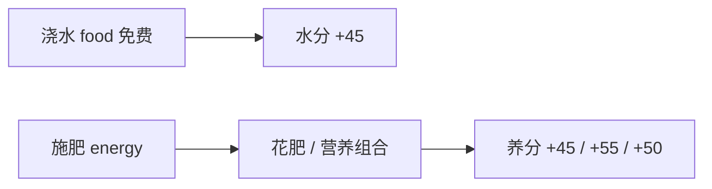

# 植物施肥与养分

Feature Name: plant-fertilize-nutrients
Updated: 2026-11-10

## Description

植物第四项由「安静生长」改为「施肥」。浇水免费、只恢复水分；施肥消耗花肥或营养组合、主要恢复养分。存量键与商品 id 不变，便于旧存档继续使用。

## Architecture

engine.js 负责动作名、商品映射、数量上限与结算。game.js 按 `products()` 是否为空决定物资选择器、库存角标与背包跳转。知识库把「薄肥勤施」归到施肥分类。

## Components and Interfaces

- `careMeta.plant.actions[3]`：施肥。
- `products(s, actionId)`：plant 的 `food` 返回空；`energy` 返回 `category` 为 `food` 或 `nutrition` 且适龄的商品。
- `begin`：plant 的 `energy` 与 `clean` 必须带消耗品；plant 的 `food` 与 `mood` 允许 `productId` 为 null。
- `careQuantityCap`：植物日常花肥上限 2，营养组合与清洁上限 1。
- `relief`：植物检查 `energy` 与 `clean`。
- `validate`：plant 允许 `food` 无商品（新浇水）以及 `food` 带花肥（进行中的旧浇水任务）；plant 的 `energy` 必须带花肥或营养组合。
- 背包 `careAct`：植物的 food/nutrition 跳到施肥。
- 小铺可用集合包含 `energy` 的 `products()`。

## Data Models

花肥仍为 `category: 'food'`，营养组合仍为 `nutrition`。gain 向量改为以养分为主：

| id | 养分 | 水分 | 价格 |
| --- | --- | --- | --- |
| plant-milk | 45 | 0 | 10 |
| plant-food-{1,2,3} | 45 | 0 | 14 / 16 / 18 |
| plant-food-{i}-plus | 55 | 0 | 比日常花肥高 6 |
| plant-nutrition | 50 | 15 | 16 |

浇水无商品时 `advance` 使用动作默认 gain：水分 45。

## Correctness Properties

- plant `careOptions` 动作名为浇水、擦叶除虫、晒太阳、施肥。
- plant `products(food)` 长度为 0；`products(energy)` 含当前阶段花肥。
- 完成免费浇水只提高 `needs[0]`。
- 完成 `plant-milk` 施肥提高 `needs[3]` 45 点（受 100 封顶）。
- 旧存档 `plant-milk` 可继续用于施肥。

## Error Handling

- 植物施肥未选消耗品：返回「请选择消耗品」。
- 施肥数量大于 2：返回「一次施肥最多两份，薄肥勤施就好」。
- 营养组合数量大于 1：返回「这次照料一次只用一份」。

## Test Strategy

- engine.test.cjs：更新植物动作名；浇水无商品、施肥消耗花肥；花肥优质档养分 55；营养组合走 energy；全类型 `products(food)` 断言对 plant 改为 `products(energy)`。
- browser.test.cjs：植物照护卡可见施肥。

## References

[^1]: (Filename) - engine.js careMeta products begin
[^2]: (Filename) - .monkeycode/specs/plant-fertilize-nutrients/requirements.md
