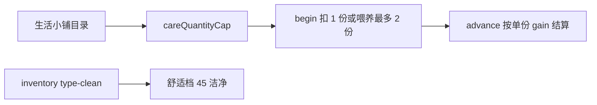

# 照护品质分档与单次动作

Feature Name: realistic-care-quality
Updated: 2026-11-09

## Description

清洁类照护（换尿裤、铲猫砂、换尿垫、擦叶）一次任务只消耗一份物资。小铺用基础 / 舒适 / 优质三档拉开单次洁净度；植物各阶段花肥增加优质档。喂养一餐最多两份，营养组合与玩具固定一份。既有 `{type}-clean` 存量键继续表示舒适档。

## Architecture

engine.js 持有目录、数量上限与结算。game.js 按上限隐藏或限制份数步进器，并在小铺/背包展示单份恢复量。存档结构不变。

## Components and Interfaces

- `catalog`：为 baby/cat/dog/plant 增加 `{type}-clean-basic`、`{type}-clean-plus`；`{type}-clean` 更名为舒适档，gain 仍为洁净 45。植物 `plant-food-{1,2,3}-plus` 养分 gain 55，价格比同阶段花肥高 6。
- `careQuantityCap(actionId, productId)`：清洁 / 营养 / 玩耍 / 休息返回 1；普通喂养返回 2。
- `begin`：数量超过上限时拒绝并给出中文说明。
- `relief`：清洁缺货时补充 `{type}-clean`（舒适档）。
- 照护弹窗：清洁与营养组合不渲染份数步进器；喂养步进上限 2。
- 小铺与背包：消耗品副文展示单份主需求恢复量。

## Data Models

商品仍为 `{ id, name, icon, category, types, minStage, price, pack, description, gain }`。任务 `quantity` 字段保留，清洁任务写入 1；载入仍接受 1–12 以便完成旧的进行中任务。

清洁档位：

| id 后缀 | 档位 | 洁净 gain | 价格 | 每组 |
| --- | --- | --- | --- | --- |
| `-clean-basic` | 基础 | 35 | 8 | 5 |
| `-clean` | 舒适 | 45 | 10 | 5 |
| `-clean-plus` | 优质 | 55 | 16 | 5 |

## Correctness Properties

- 清洁 `begin` 的 `quantity` 为 1，任务秒数等于动作基础时长。
- 喂养 `quantity` 属于 {1, 2}；营养组合 `quantity` 为 1。
- 优质清洁完成且洁净度有余量时，洁净度增加 55（受 100 封顶）。
- 旧存档 `{type}-clean` 可继续用于清洁动作。
- 品质商品描述含游戏化免责声明。

## Error Handling

- 清洁或多于 2 份的喂养：返回「这次照料一次只用一份」或「一餐最多两份，一次喂完就好」。
- 非整数或小于 1 的数量：返回「物资数量无效」。
- 不适龄或库存不足的既有校验保持不变。

## Test Strategy

- engine.test.cjs：目录三档与花肥优质档；清洁拒绝 quantity>1；喂养接受 2、拒绝 3；营养组合拒绝 2；旧 `{type}-clean` 仍可 begin；优质清洁 +55。
- 调整既有「quantity 12 / 6 份喂养」用例以匹配新上限。
- browser.test.cjs：喂养仍可加到 2 份；清洁弹窗无份数步进器。

## References

[^1]: (Filename) - engine.js catalog and begin
[^2]: (Filename) - .monkeycode/specs/realistic-care-quality/requirements.md
