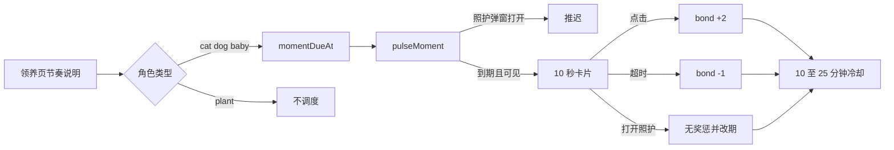

# 短时小事件

Feature Name: short-moments
Updated: 2026-11-11

## Description

小猫、小狗、宝宝在冷却结束后偶尔弹出一条 10 秒轻互动。点到亲密度 +2，错过 −1。小植物不参与。领养页写明互动节奏差别。引擎保持无内置随机源，由调用方传入 0–1 的 `roll`。

## Architecture



冷却与上次文案 id 写入 v2 存档。进行中的 10 秒窗口只存在于本次页面会话。

## Components and Interfaces

- `moments(type)`：该类型文案池；植物返回空数组。
- `scheduleMoment(s, now, roll)`：写入 `momentDueAt = now + 10min + floor(roll * 15min)`。
- `startMoment(s, now, roll)`：校验类型、存活、健康度 ≥20、已到点；抽取与 `momentLastId` 不同的条目并返回 `{id, prompt, action, until}`，`until = now + 10000`。
- `resolveMoment(s, now, outcome)`：`hit` 亲密度 +2 并记日记；`miss` 亲密度 −1 并记日记；`defer` 不改亲密度。随后 `scheduleMoment`。
- 界面：`#moment-card` 浮层；`pulseMoment` 挂在 250ms tick。照护弹窗打开时不 `start`；若窗口进行中则 `defer`。
- 领养：`profiles[].rhythm` 卡片短句；摘要补一句短时事件或安静养成。

## Data Models

```
momentDueAt: number | null
momentLastId: string | null
```

旧档缺字段时按 `null` 补齐。进行中事件不入库。

## Correctness Properties

- 植物 `moments('plant').length === 0`，`startMoment` 返回 `null`。
- `hit` 后亲密度增量为 2 或触顶；`miss` 后减量为 1 或触底。
- 连续两次 `startMoment` 的 id 不同。
- `scheduleMoment` 的间隔落在 `[10min, 25min)`。
- 打开照护弹窗时进行中事件走 `defer`，亲密度不变。

## Error Handling

- `roll` 越界或非数字：引擎抛错。
- 未领养、已离开、健康度 <20、植物、未到点：`startMoment` 返回 `null`。
- 无进行中事件时界面忽略点击。

## Test Strategy

- engine.test.cjs：植物空池；猫狗宝宝三类文案；hit/miss/defer 亲密度；冷却区间；连续 id 不同；旧档缺字段可加载。
- browser.test.cjs：领养页植物摘要含「安静」；猫摘要含短时事件；强制 `startMoment` 后点击亲密度 +2。

## References

[^1]: engine.js create validate adopt
[^2]: game.js renderAdoption pulseMoment
[^3]: .monkeycode/specs/short-moments/requirements.md
